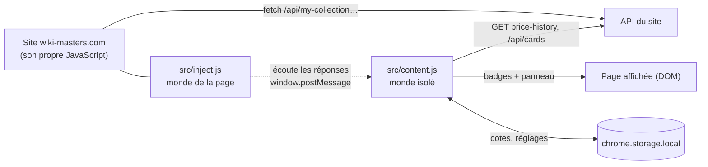

# WikiMastered – Cotes et amis

Extension de navigateur pour [Wiki Masters](https://www.wiki-masters.com/), **en lecture seule** :

- **Cotes sur les cartes** : un badge `≈ 1 250` sur chaque carte affichée (ta collection, le marché, le profil d'un ami). La cote est la moyenne des ventes récentes dans la rareté de la carte, tirée de l'historique des prix du site, avec le même calcul que le bot [WikiMastered](https://github.com/MaKSiiMe/WikiMastered).
- **Ta liste de souhaits chez tes amis** : pour chaque carte de ta liste, les amis qui l'ont et dans quelles raretés, avec un filtre « SR et plus », etc. Un clic sur le pseudo ouvre son profil, d'où tu proposes l'échange.

Elle ne clique, ne mise, ne vend et n'étiquette jamais rien. Elle fait seulement des lectures, comme le site quand tu ouvres une carte ou ta liste de souhaits : une à la fois, au moins une seconde d'écart, et une pause d'une minute si le site dit « trop de requêtes ». Les cotes sont gardées 6 h dans le navigateur.

## Installation

### Chrome, Brave, Edge, Opera

1. Télécharge le dépôt (bouton **Code → Download ZIP**) et dézippe-le, ou clone-le avec `git clone`.
2. Ouvre `chrome://extensions` (ou `brave://extensions`, `edge://extensions`, `opera://extensions`).
3. Active le **Mode développeur** (en haut à droite).
4. **Charger l'extension non empaquetée** et choisis le dossier qui contient `manifest.json`.
5. Ouvre ou recharge [ta collection](https://www.wiki-masters.com/collection).

Chrome affiche un avertissement « Unrecognized manifest key 'browser_specific_settings' » : c'est la ligne réservée à Firefox, sans effet sur Chrome.

### Firefox (128 ou plus)

1. Ouvre `about:debugging#/runtime/this-firefox`.
2. **Charger un module complémentaire temporaire…** et choisis le fichier `manifest.json` du dossier.
3. Recharge la page du site.

Firefox oublie une extension temporaire à sa fermeture : il faut la recharger à chaque démarrage, tant qu'elle n'est pas signée par Mozilla.

## Utilisation

- Le bouton rond **WM** en bas à gauche ouvre le panneau (raccourci `Alt+Maj+W`).
- **Prix** : combien de cartes sont repérées, la valeur des cartes affichées, les badges à cacher ou montrer, et « Relire toutes les cotes ».
- **Amis** : la liste se lit à la première ouverture de l'onglet (~1 requête par tranche de 50 cartes de ta liste), puis reste en mémoire une heure. **Actualiser** la relit.
- Survole un badge pour le détail : nombre de ventes, ancienneté de la cote, cotes des autres raretés.

## Comment ça marche (pour apprendre)

Une extension, c'est un dossier avec un fichier `manifest.json` qui dit au navigateur quoi charger, et où.



| Fichier | Rôle |
|---|---|
| [`manifest.json`](manifest.json) | La carte d'identité : nom, version, sites concernés (`host_permissions`), droits (`storage`), scripts à injecter. Manifest V3, le format actuel de Chrome et Firefox. |
| [`src/inject.js`](src/inject.js) | Tourne **dans** la page (`"world": "MAIN"`), avant le site. Il enveloppe `window.fetch` pour recopier les réponses de l'API qui contiennent des cartes. Il ne modifie rien. |
| [`src/content.js`](src/content.js) | Le *content script* : il voit la page (le DOM) mais vit dans un monde à part, invisible du site. Il reçoit les réponses copiées, demande les cotes, pose les badges et dessine le panneau. |
| [`src/lib.js`](src/lib.js) | Les calculs purs (cote, cartes d'une réponse, amis) : aucun accès au navigateur, donc testables simplement. |
| [`src/styles.css`](src/styles.css) | Le style des badges et du panneau, tout préfixé `wme-`. |
| [`tests/lib.test.js`](tests/lib.test.js) | Les tests de `lib.js`, avec le lanceur de tests intégré à Node. |

Points à retenir :

- **Deux mondes.** Un content script ne voit pas les variables du site, et le site ne voit pas les siennes : c'est une protection. Pour savoir ce que le site a reçu, on passe par un petit script injecté dans la page, qui parle au content script par `window.postMessage`.
- **Le site change sans prévenir.** Ses classes CSS sont générées et bougent à chaque mise à jour. On retrouve donc une carte par son **titre** dans le texte de la page, puis on remonte au premier parent qui contient une image : c'est la tuile de la carte. L'idée vient de [wm-qol](https://github.com/Kitsoune/wm-qol).
- **Application d'une seule page.** Le site remplace des morceaux de page sans recharger. Un `MutationObserver` relance la pose des badges quand la page change.
- **Rien d'interprété.** Les titres et pseudos viennent du site : ils sont posés en texte (`textContent`), jamais en HTML (`innerHTML`), pour qu'un titre piégé ne puisse pas exécuter de code.

## Développement

```sh
npm test         # tests de src/lib.js (Node 20 ou plus, aucune dépendance à installer)
npm run build    # dist/wikimastered-extension-<version>.zip
```

Après une modification, clique sur ↻ dans `chrome://extensions` (ou **Recharger** dans `about:debugging`), puis recharge la page du site. Les erreurs du content script s'affichent dans la console de la page (F12).

## Limites connues

- **Shiny** : l'historique des prix du site ne les distingue pas ; le badge d'une carte shiny montre la cote de la carte ordinaire.
- **Rareté d'une tuile** : lue dans le texte de la tuile (« SR », « L »…). Si elle n'y est pas écrite et que la carte existe dans plusieurs raretés sur la page, le badge affiche `?`.
- **Version 0.1** : testée sur une copie simulée du site, pas encore sur le vrai. Si un badge manque ou se pose au mauvais endroit, ouvre une issue avec une capture.

## Licence

MIT
