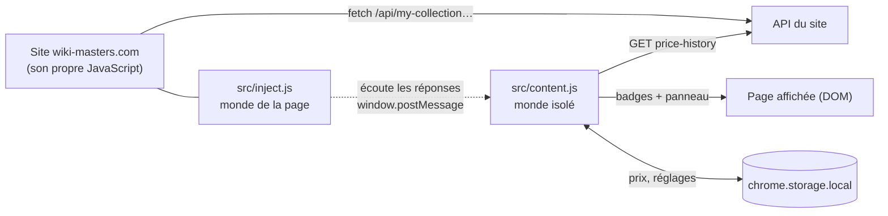

# WikiMastered – Prix des cartes

Extension de navigateur pour [Wiki Masters](https://www.wiki-masters.com/), **en lecture seule** : un badge `≈ 1 250` sur chaque carte affichée (ta collection, le marché, le détail d'un échange…), collé à droite du badge de rareté et dans son style. Sur un profil, le prix n'apparaît qu'au survol de la carte : une vitrine se regarde. C'est le **prix moyen du site**, le même chiffre que sur la fiche de la carte (« Prix moyen de la semaine », ou « Dernier prix moyen connu » si la semaine n'a pas encore de vente), dans la rareté de la carte.

Elle ne clique, ne mise, ne vend et n'étiquette jamais rien. Elle fait seulement des lectures, comme le site quand tu ouvres la fiche d'une carte : une à la fois, au moins une demi-seconde d'écart, et une pause d'une minute si le site dit « trop de requêtes ». Les prix sont gardés 6 h dans le navigateur.

## Feuille de route

| Version | Contenu |
|---|---|
| **v0** (en cours) | Le prix moyen sur chaque carte. Rien d'autre, mais qui marche. |
| v1 | Ce que font les autres extensions (tri de la collection par prix, valeur du compte, doublons…), et plus. |
| v2 | Synchronisée avec le bot [WikiMastered](https://github.com/MaKSiiMe/WikiMastered). |

## D'où vient le prix

Le site ne donne pas de prix dans sa liste de cartes. Sur la fiche d'une carte, il demande l'historique de ses ventes (`/api/marketplace/cards/{id}/price-history`) et calcule lui-même, dans le navigateur, la moyenne de la dernière semaine qui a des ventes. L'extension fait la même requête et le même calcul : une requête par carte, comme le site, gardée 6 h. Une page de 50 cartes jamais vues prend une trentaine de secondes la première fois, puis s'affiche aussitôt.

## Installation

### Chrome, Brave, Edge, Opera

1. Clone le dépôt une fois pour toutes : `git clone https://github.com/MaKSiiMe/WikiMastered-extension.git` (ou **Code → Download ZIP**, mais il faudra alors tout retélécharger à chaque version).
2. Ouvre `chrome://extensions` (ou `brave://extensions`, `edge://extensions`, `opera://extensions`).
3. Active le **Mode développeur** (en haut à droite).
4. **Charger l'extension non empaquetée** et choisis le dossier qui contient `manifest.json`.
5. Ouvre ou recharge [ta collection](https://www.wiki-masters.com/collection).

Chrome affiche un avertissement « Unrecognized manifest key 'browser_specific_settings' » : c'est la ligne réservée à Firefox, sans effet sur Chrome.

### Mettre à jour (Chrome)

Chrome lit l'extension directement dans le dossier choisi : pas besoin de la supprimer.

1. Récupère la nouvelle version dans le dossier : `git pull`.
2. Dans `chrome://extensions`, clique sur ↻ sous l'extension.
3. Recharge la page du site.

Le numéro de version s'affiche en haut du panneau (bouton **WM**) : c'est le moyen de vérifier que la bonne version tourne.

### Firefox (128 ou plus)

1. Ouvre `about:debugging#/runtime/this-firefox`.
2. **Charger un module complémentaire temporaire…** et choisis le fichier `manifest.json` du dossier.
3. Recharge la page du site.

Firefox oublie une extension temporaire à sa fermeture : il faut la recharger à chaque démarrage, tant qu'elle n'est pas signée par Mozilla.

## Utilisation

- Le bouton rond **WM** en bas à gauche ouvre le panneau (raccourci `Alt+Maj+W`) : combien de cartes sont repérées, la valeur des cartes affichées, les badges à cacher ou montrer, et « Relire tous les prix ».
- Survole un badge pour le détail : semaine du prix, nombre de ventes, prix des autres raretés si la carte n'a pas de vente dans la sienne.

## Comment ça marche (pour apprendre)

Une extension, c'est un dossier avec un fichier `manifest.json` qui dit au navigateur quoi charger, et où.



| Fichier | Rôle |
|---|---|
| [`manifest.json`](manifest.json) | La carte d'identité : nom, version, sites concernés (`host_permissions`), droits (`storage`), scripts à injecter. Manifest V3, le format actuel de Chrome et Firefox. |
| [`src/inject.js`](src/inject.js) | Tourne **dans** la page (`"world": "MAIN"`), avant le site. Il enveloppe `window.fetch` pour recopier les réponses de l'API ; `lib.js` y cherche les cartes, où qu'elles soient. Il ne modifie rien. |
| [`src/content.js`](src/content.js) | Le *content script* : il voit la page (le DOM) mais vit dans un monde à part, invisible du site. Il reçoit les réponses copiées, demande les prix, pose les badges et dessine le panneau. |
| [`src/lib.js`](src/lib.js) | Les calculs purs (prix moyen, cartes d'une réponse) : aucun accès au navigateur, donc testables simplement. |
| [`src/styles.css`](src/styles.css) | Le style des badges et du panneau, tout préfixé `wme-`. |
| [`tests/lib.test.js`](tests/lib.test.js) | Les tests de `lib.js`, avec le lanceur de tests intégré à Node. |

Points à retenir :

- **Deux mondes.** Un content script ne voit pas les variables du site, et le site ne voit pas les siennes : c'est une protection. Pour savoir ce que le site a reçu, on passe par un petit script injecté dans la page, qui parle au content script par `window.postMessage`.
- **Le site change sans prévenir.** Ses classes CSS sont générées et bougent à chaque mise à jour. On retrouve donc une carte par son **titre** dans le texte de la page, puis on remonte au premier parent qui contient une image : c'est la tuile de la carte. L'idée vient de [wm-qol](https://github.com/Kitsoune/wm-qol).
- **Application d'une seule page.** Le site remplace des morceaux de page sans recharger. Un `MutationObserver` relance la pose des badges quand la page change.
- **Rien d'interprété.** Les titres viennent du site : ils sont posés en texte (`textContent`), jamais en HTML (`innerHTML`), pour qu'un titre piégé ne puisse pas exécuter de code.

## Développement

```sh
npm test         # tests de src/lib.js (Node 20 ou plus, aucune dépendance à installer)
npm run build    # dist/wikimastered-extension-<version>.zip
```

Après une modification, clique sur ↻ dans `chrome://extensions` (ou **Recharger** dans `about:debugging`), puis recharge la page du site. Les erreurs du content script s'affichent dans la console de la page (F12).

## Limites connues

- **Shiny** : le site ne donne aucun prix propre aux shiny (son historique les mélange aux cartes ordinaires). Le badge d'une carte shiny affiche `✦ ?`, avec le prix de la carte ordinaire dans l'infobulle. Le bot relève les vraies ventes shiny : la v2 (synchro avec le bot) pourra les afficher.
- **Rareté d'une tuile** : lue sur le badge de rareté de la carte (« SR », « L✦ »…), dont le badge de prix reprend le style. Sans badge de rareté, le prix prend un style neutre et la rareté vient des données du site ; `?` si la carte y existe en plusieurs raretés.
- **v0** : testée sur une copie simulée du site, pas encore sur le vrai. Si un badge manque ou se pose au mauvais endroit, ouvre une issue avec une capture.

## Licence

MIT
