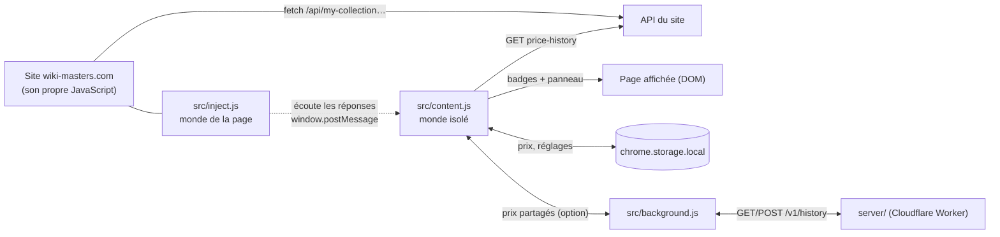

# WikiMastered – Prix des cartes

Extension de navigateur pour [Wiki Masters](https://www.wiki-masters.com/) : un badge `≈ 1 250` sur chaque carte affichée (ta collection, le marché, la Collection globale, le détail d'un échange…), en haut au centre de la carte, dans le style de son badge de rareté. Sur un échange affiché, une ligne de bilan : ce que chaque côté donne (cartes au prix moyen + WB) et qui y gagne. Sur un profil, le prix n'apparaît qu'au survol de la carte : une vitrine se regarde. C'est le **prix moyen du site**, le même chiffre que sur la fiche de la carte (« Prix moyen de la semaine », ou « Dernier prix moyen connu » si la semaine n'a pas encore de vente), dans la rareté de la carte.

Pour les prix, elle fait seulement des lectures, comme le site quand tu ouvres la fiche d'une carte : une à la fois, au moins une demi-seconde d'écart, et au plus 80 lectures par 10 minutes, tous onglets confondus (le site bloque vers 90-100). Si le site demande d'arrêter (trop de requêtes, quota atteint, vérification humaine), tous les onglets font la pause qu'il indique, affichée dans la fenêtre de l'extension. Les prix sont gardés 6 h dans le navigateur.

En option, désactivée par défaut, elle peut aussi cliquer à ta place : ouvrir tes paquets sur `/pulls` dès qu'ils sont disponibles, et tenter de débloquer le marché en lançant une enchère depuis `/collection` (voir [Automatisation par clic](#automatisation-par-clic-optionnelle)).

## Feuille de route

| Version | Pour qui | Contenu |
|---|---|---|
| **v0** (en cours) | tout le monde | Le prix moyen sur chaque carte, le bilan d'un échange, la fenêtre de l'extension ; en 0.4, l'automatisation par clic optionnelle et le récap des paquets. |
| v1 | le collectionneur | Prix des shiny, courbe de prix, tableau de bord de la collection, filtres, familles, liste de souhaits chiffrée ; Chrome Web Store et Firefox signé. |
| v2 | l'investisseur | Synchronisée avec le bot [WikiMastered](https://github.com/MaKSiiMe/WikiMastered) : onglet « Bot », Stonks (profit réalisé et latent), trafic Wikipédia, alertes. |

Le détail, case par case, avec les idées reprises des autres outils : [ROADMAP.md](ROADMAP.md).

## D'où vient le prix

Le site ne donne pas de prix dans sa liste de cartes. Sur la fiche d'une carte, il demande l'historique de ses ventes (`/api/marketplace/cards/{id}/price-history`) et calcule lui-même, dans le navigateur, la moyenne de la dernière semaine qui a des ventes. L'extension fait la même requête et le même calcul : une requête par carte, comme le site, gardée 6 h. Une page de 50 cartes jamais vues prend une trentaine de secondes la première fois, puis s'affiche aussitôt ; au-delà de 80 cartes nouvelles en 10 minutes, les suivantes attendent que le budget se libère.

### Prix partagés (essai, désactivé par défaut)

Le quota du site est par compte : seul, on ne lit pas plus de 80 cartes par 10 minutes. Avec **Prix partagés** (fenêtre de l'extension), plusieurs joueurs et leurs bots mettent leurs lectures en commun sur un petit serveur ([`server/`](server/), un Cloudflare Worker) : avant de lire une carte sur le site, l'extension demande au serveur si quelqu'un l'a lue depuis moins de 6 h, en une requête pour toute la page ; chaque lecture faite sur le site y est déposée. Chacun continue de lire seulement ce qu'il regarde, dans son propre quota. L'infobulle d'un badge dit qui a relevé le prix (« par pote-bot »). Seuls l'identifiant de la carte et l'historique des prix partent vers le serveur : ni pseudo, ni cookie, ni collection.

Pour l'activer : coche la case, colle l'adresse du serveur (`https://….workers.dev`) et ton jeton, puis **Enregistrer** ; le navigateur demande l'autorisation de joindre ce serveur. Mise en route du serveur : [server/README.md](server/README.md).

## Installation

### Chrome, Brave, Edge, Opera

1. Clone le dépôt une fois pour toutes : `git clone https://github.com/MaKSiiMe/WikiMastered-extension.git` (ou **Code → Download ZIP**, mais il faudra alors tout retélécharger à chaque version).
2. Ouvre `chrome://extensions` (ou `brave://extensions`, `edge://extensions`, `opera://extensions`).
3. Active le **Mode développeur** (en haut à droite).
4. **Charger l'extension non empaquetée** et choisis le dossier qui contient `manifest.json`.
5. Ouvre ou recharge [ta collection](https://www.wiki-masters.com/collection).

Chrome affiche un avertissement « Unrecognized manifest key 'browser_specific_settings' » : c'est la ligne réservée à Firefox, sans effet sur Chrome.

Sans git : chaque version publiée a son archive `.zip` dans [Releases](https://github.com/MaKSiiMe/WikiMastered-extension/releases). Dézippe-la et choisis ce dossier à l'étape 4.

### Mettre à jour (Chrome)

Chrome lit l'extension directement dans le dossier choisi : pas besoin de la supprimer.

1. Récupère la nouvelle version dans le dossier : `git pull` (ou dézippe la nouvelle archive par-dessus l'ancienne).
2. Dans `chrome://extensions`, clique sur ↻ sous l'extension.
3. Recharge la page du site.

Le numéro de version s'affiche en haut de la fenêtre de l'extension : c'est le moyen de vérifier que la bonne version tourne.

### Firefox (128 ou plus)

1. Ouvre `about:debugging#/runtime/this-firefox`.
2. **Charger un module complémentaire temporaire…** et choisis le fichier `manifest.json` du dossier.
3. Recharge la page du site.

Firefox oublie une extension temporaire à sa fermeture : il faut la recharger à chaque démarrage, tant qu'elle n'est pas signée par Mozilla.

## Utilisation

- L'icône de l'extension (la carte dorée, à épingler via la pièce de puzzle de la barre d'outils) ouvre sa fenêtre, comme le raccourci `Alt+Maj+W` (Chrome ne le pose qu'à la première installation : sinon, règle-le dans `chrome://extensions/shortcuts`) : combien de cartes ont un badge, leur valeur, le bilan de l'échange affiché, les badges à cacher ou montrer, les deux cases de l'automatisation par clic avec son état, et « Relire tous les prix ».
- Survole un badge pour le détail : semaine du prix, nombre de ventes, prix des autres raretés si la carte n'a pas de vente dans la sienne.

### Automatisation par clic (optionnelle)

Deux cases dans la fenêtre de l'extension, décochées par défaut. Elles ne changent jamais de page sous tes yeux : l'extension attend que tu n'aies ni cliqué, ni tapé, ni fait défiler depuis 5 minutes.

- **Ouverture auto des packs** : sur `/pulls`, l'extension clique sur « Ouvrir un paquet » dès qu'un paquet est disponible, puis recharge la page (plutôt que de faire défiler les cartes une à une). Sans paquet prêt, elle recharge `/pulls` toutes les 3 minutes. Si le site limite les ouvertures (trop rapprochées, ou limite du jour), elle attend la date qu'il indique. Si l'ouverture d'un paquet est bloquée par une vérification, elle rejoint `/pulls`, attend que tu la valides, puis revient à ta page (au plus un départ toutes les 10 minutes, et jamais sans 5 minutes d'inactivité, comptées sur toutes les pages du site). Elle ne clique jamais sur une vérification.
- **Récap des paquets** : chaque paquet ouvert, par l'automatisation ou à la main, est noté dans la fenêtre de l'extension : nombre de paquets (dont combien en auto) et de cartes, répartition par rareté, shiny, valeur totale au prix moyen du moment de l'ouverture, les 3 meilleurs tirages. Si l'extension « WikiMasters - Prix moyen collection » est installée, ses compteurs de tirages (par rareté) sont repris une fois comme point de départ de la répartition : sans prix ni détail, et sans compter deux fois les paquets que les deux extensions ont vus. Une carte « L+ » compte en L. Le bouton « Remettre le récap à zéro » repart de rien, cartes reprises comprises ; au-delà de 10 000 paquets (environ 50 000 cartes), les plus anciens sont oubliés.
- **Tentative de déblocage marché** : si le marché est bloqué depuis 5 minutes, l'extension va sur `/collection`, met la première carte aux enchères à 100 000 WB pour 10 minutes, laisse la vérification apparaître, puis revient. **Attention : c'est une vraie enchère.** La carte est bloquée pendant 10 minutes et vendue si quelqu'un paie ce prix.

## Comment ça marche (pour apprendre)

Une extension, c'est un dossier avec un fichier `manifest.json` qui dit au navigateur quoi charger, et où.



| Fichier | Rôle |
|---|---|
| [`manifest.json`](manifest.json) | La carte d'identité : nom, version, sites concernés (`host_permissions`), droits (`storage`), scripts à injecter. Manifest V3, le format actuel de Chrome et Firefox. |
| [`src/inject.js`](src/inject.js) | Tourne **dans** la page (`"world": "MAIN"`), avant le site. Il enveloppe `window.fetch` pour recopier les réponses de l'API ; `lib.js` y cherche les cartes, où qu'elles soient. Il signale aussi à `click.js` chaque ouverture de paquet, réussie ou bloquée par une vérification. Il ne modifie aucune réponse. |
| [`src/click.js`](src/click.js) | L'automatisation par clic : deux boucles (paquets, marché) qui relisent leurs réglages à chaque tour et se passent le relais d'une page à l'autre par `chrome.storage.local`. Son état s'affiche dans la fenêtre de l'extension. |
| [`src/content.js`](src/content.js) | Le *content script* : il voit la page (le DOM) mais vit dans un monde à part, invisible du site. Il reçoit les réponses copiées, demande les prix, pose les badges et le bilan des échanges, et répond à la fenêtre de l'extension. |
| [`src/background.js`](src/background.js) | Le script d'arrière-plan, seul à parler au serveur de prix partagés : le content script n'a pas le droit d'appeler un autre site que wiki-masters.com. |
| [`server/`](server/) | Le serveur de prix partagés (Cloudflare Worker + base D1), optionnel : voir [server/README.md](server/README.md). |
| [`src/lib.js`](src/lib.js) | Les calculs purs (prix moyen, cartes et échanges d'une réponse, bilan d'un échange, récap des paquets) : aucun accès au navigateur, donc testables simplement. |
| [`src/popup.html`](src/popup.html), [`src/popup.js`](src/popup.js) | La fenêtre ouverte par l'icône (`action` dans le manifeste). Elle ne voit pas la page : elle demande l'état au content script de l'onglet par `chrome.tabs.sendMessage`. |
| [`src/styles.css`](src/styles.css) | Le style des badges et du bilan, tout préfixé `wme-`. |
| [`icons/`](icons/) | L'icône, dessinée par [`tools/icons.py`](tools/icons.py) (Python sans dépendance). |
| [`tests/`](tests/) | Les tests de `lib.js` et des règles du serveur (`server/src/logic.js`), avec le lanceur de tests intégré à Node. |

Points à retenir :

- **Deux mondes.** Un content script ne voit pas les variables du site, et le site ne voit pas les siennes : c'est une protection. Pour savoir ce que le site a reçu, on passe par un petit script injecté dans la page, qui parle au content script par `window.postMessage`.
- **Le site change sans prévenir.** Ses classes CSS sont générées et bougent à chaque mise à jour. On retrouve donc une carte par son **titre** dans le texte de la page, puis on remonte au premier parent qui contient une image : c'est la tuile de la carte. L'idée vient de [wm-qol](https://github.com/Kitsoune/wm-qol).
- **Copies gardées par le site.** Certaines pages (Collection globale) gardent leur dernière réponse dans le `sessionStorage` de l'onglet et ne la redemandent pas : l'extension y lit aussi les cartes.
- **Application d'une seule page.** Le site remplace des morceaux de page sans recharger. Un `MutationObserver` relance la pose des badges quand la page change.
- **Des clics comme les tiens.** `click.js` appelle `bouton.click()` sur les boutons du site, qu'il retrouve par leur texte ou leur image. Pour remplir un champ géré par React, écrire `input.value` ne suffit pas : on passe par le *setter* natif du navigateur, puis on émet les événements `input` et `change`. Les gestes simulés ont `isTrusted` à `false` : c'est ainsi que l'extension distingue tes vrais clics des siens.
- **Rien d'interprété.** Les titres viennent du site : ils sont posés en texte (`textContent`), jamais en HTML (`innerHTML`), pour qu'un titre piégé ne puisse pas exécuter de code.

## Développement

```sh
npm test         # tests de src/lib.js et server/src/logic.js (Node 20 ou plus, aucune dépendance à installer)
npm run build    # dist/wikimastered-extension-<version>.zip
```

Publier une version : monter `version` dans `manifest.json` et `package.json`, fusionner, puis pousser l'étiquette `v<version>` (`git tag v0.4.0 && git push origin v0.4.0`). Le workflow [`release.yml`](.github/workflows/release.yml) teste, fabrique l'archive et crée la page de la version avec le `.zip`.

Après une modification, clique sur ↻ dans `chrome://extensions` (ou **Recharger** dans `about:debugging`), puis recharge la page du site. Les erreurs du content script s'affichent dans la console de la page (F12).

## Limites connues

- **Shiny** : le site ne donne aucun prix propre aux shiny (son historique les mélange aux cartes ordinaires). Le badge d'une carte shiny affiche `✦ ?`, avec le prix de la carte ordinaire dans l'infobulle. Le bot relève les vraies ventes shiny : la v2 (synchro avec le bot) pourra les afficher.
- **Rareté d'une tuile** : lue sur le badge de rareté de la carte (« SR », « L✦ »…), dont le badge de prix reprend le style. Sans badge de rareté, le prix prend un style neutre et la rareté vient des données du site ; `?` si la carte y existe en plusieurs raretés.
- **Bilan d'un échange** : posé sous les cartes de l'échange, dès qu'au moins une carte de chaque côté est visible (une carte sans image n'est pas repérée, mais son prix compte quand même). Une carte shiny ou sans vente compte pour 0 et le bilan le signale (« 1 carte sans prix »).
- **Automatisation par clic** : les boutons sont retrouvés par leur texte (« Ouvrir un paquet », « Mettre aux enchères », « Lancer l'enchère ») : si le site les renomme, l'étape échoue et l'extension revient à ta page. Le déblocage du marché attend un signal (`wmNeedVerify`) que rien n'écrit encore : pour l'instant, il ne se déclenche pas.
- **`?` sur un badge** : le site a refusé la lecture du prix trois fois de suite (souvent parce qu'il est surchargé, ou qu'une autre extension le sollicite en même temps). Survole le badge pour l'erreur ; nouvel essai au bout de 10 minutes.

## Licence

MIT
