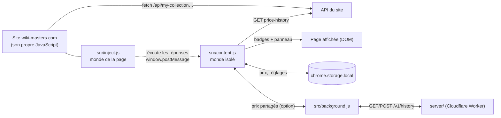

# WikiMastered – Prix des cartes

Extension de navigateur pour [Wiki Masters](https://www.wiki-masters.com/) : un badge `1 250` sur chaque carte affichée (`≈ 1 250` quand le prix repose sur trop peu de ventes : moins de 5 dans la semaine, seuil réglable dans le panneau ; `⚠ 42`, contour orange, quand une vente isolée hors de proportion fausse le prix du site : le prix habituel, le chiffre du site au survol) (ta collection, le marché, la Collection globale, le détail d'un échange…), en haut au centre de la carte, dans le style de son badge de rareté. Sur un échange affiché, une ligne de bilan : ce que chaque côté donne (cartes au prix moyen + WB) et qui y gagne. Sur un profil, le prix n'apparaît qu'au survol de la carte : une vitrine se regarde. C'est le **prix moyen du site**, le même chiffre que sur la fiche de la carte (« Prix moyen de la semaine », ou « Dernier prix moyen connu » si la semaine n'a pas encore de vente), dans la rareté de la carte.

Pour les prix, elle fait seulement des lectures, comme le site quand tu ouvres la fiche d'une carte : au moins une demi-seconde d'écart, et au plus 80 lectures par 10 minutes sur chacune des deux routes de prix, tous onglets confondus (le site bloque vers 90-100). Si le site demande d'arrêter (trop de requêtes, quota atteint, vérification humaine), tous les onglets font la pause qu'il indique, affichée dans le panneau de l'extension. Un prix est relu au bout de 6 h et reste affiché pendant sa relecture : normalement jusqu'à 24 h, grisé au-delà (7 jours au plus).

En option, désactivée par défaut, elle peut aussi cliquer à ta place : ouvrir tes paquets sur `/pulls` dès qu'ils sont disponibles, et tenter de débloquer le marché en lançant une enchère depuis `/collection` (voir [Automatisation par clic](#automatisation-par-clic-optionnelle)).

## Feuille de route

| Version | Pour qui | Contenu |
|---|---|---|
| **v0** (en cours) | tout le monde | Le prix moyen sur chaque carte, le bilan d'un échange, le panneau de l'extension ; en 0.4, l'automatisation par clic optionnelle et le récap des paquets. |
| v1 | le collectionneur | Courbe de prix, tableau de bord de la collection, filtres, liste de souhaits chiffrée, échanges chiffrés ; Chrome Web Store et Firefox signé. |
| v2 | l'investisseur | Synchronisée avec le bot [WikiMastered](https://github.com/MaKSiiMe/WikiMastered) : onglet « Bot », Stonks (profit réalisé et latent), trafic Wikipédia, alertes. |

Le détail, case par case, avec les idées reprises des autres outils : [ROADMAP.md](ROADMAP.md).

## D'où vient le prix

Le site ne donne pas de prix dans sa liste de cartes. Sur la fiche d'une carte, il demande l'historique de ses ventes (`/api/marketplace/cards/{id}/price-history`) et calcule lui-même, dans le navigateur, la moyenne de la dernière semaine qui a des ventes (semaines du lundi, heure de Paris). Une exception : une semaine de moins de 10 ventes dont la moyenne est plus de 3 fois au-dessus ou au-dessous des 8 dernières semaines (15 septembre SR, une vente à 8 067 contre ~40) est écartée, et le badge marqué « ⚠ » prend la dernière semaine normale. L'extension fait le même calcul, une requête par carte, par deux routes qui ont chacune leur quota :

- **`/price-history`**, la même que la fiche ;
- **`/sales`**, les 5 dernières ventes de la carte : pour une carte vendue moins de 5 fois en tout (la plupart des C, PC et R), c'est toute son histoire, dont l'extension refait exactement le même historique. Sinon, la carte passe par `/price-history`. Méthode reprise de [LeadOn/Wikimasters-Toolbox](https://github.com/LeadOn/Wikimasters-Toolbox).

Les cartes à l'écran sont lues d'abord, puis celles juste en dessous ; une carte qui a quitté la page n'est plus lue. Une fiche que tu ouvres sur le site donne son prix sans aucune requête de plus. Un prix est relu au bout de 6 h et reste affiché pendant sa relecture, grisé s'il a plus de 24 h (7 jours au plus) : une page déjà vue s'affiche tout de suite. Une page de 50 cartes jamais vues prend une vingtaine de secondes la première fois ; au-delà du budget (80 lectures par route et par 10 minutes, et au plus 10 en 30 secondes pour les deux routes ensemble), les suivantes attendent qu'il se libère. Après un refus « quota » du site, ces limites sont divisées par deux pendant 24 h.

Le quota exact de `/sales` n'est pas connu. Chaque refus du site est noté dans le panneau de l'extension, avec le nombre de lectures de la route juste avant (10 dernières minutes, dernière minute) : de quoi caler les budgets sur ce que le site tolère vraiment, sans le chercher. Les lectures d'une autre extension de prix sur le même compte n'y sont pas comptées, mais le site les compte : mieux vaut n'en garder qu'une active.

### Prix partagés (essai, désactivé par défaut)

Le quota du site est par compte : seul, on ne lit pas plus de 80 cartes par route et par 10 minutes. Avec **Prix partagés** (panneau de l'extension, onglet Réglages), plusieurs joueurs et leurs bots mettent leurs lectures en commun sur un petit serveur ([`server/`](server/), un Cloudflare Worker) : avant de lire une carte sur le site, l'extension demande au serveur si quelqu'un l'a lue dans la semaine, en une requête pour toute la page (plus de 6 h : affichée grisée, puis relue) ; chaque lecture faite sur le site y est déposée. Chacun continue de lire seulement ce qu'il regarde, dans son propre quota. L'infobulle d'un badge dit qui a relevé le prix (« par jarry (bot) »). Seuls l'identifiant de la carte et l'historique des prix partent vers le serveur : ni pseudo, ni cookie, ni collection.

Pour l'activer : coche la case, colle l'adresse du serveur (`https://….workers.dev`) et ton jeton, puis **Enregistrer** ; le navigateur demande l'autorisation de joindre ce serveur. Mise en route du serveur : [server/README.md](server/README.md).

## Installation

### Chrome, Brave, Edge, Opera

1. Clone le dépôt une fois pour toutes : `git clone https://github.com/MaKSiiMe/WikiMastered-extension.git` (ou **Code → Download ZIP**, mais il faudra alors tout retélécharger à chaque version).
2. Ouvre `chrome://extensions` (ou `brave://extensions`, `edge://extensions`, `opera://extensions`).
3. Active le **Mode développeur** (en haut à droite).
4. **Charger l'extension non empaquetée** et choisis le dossier qui contient `manifest.json`.
5. Ouvre ou recharge [ta collection](https://www.wiki-masters.com/collection).

Depuis le dépôt, Chrome affiche un avertissement sur les lignes réservées à Firefox (`browser_specific_settings`, `sidebar_action`) : elles sont sans effet sur Chrome.

Sans git : chaque version publiée a deux archives dans [Releases](https://github.com/MaKSiiMe/WikiMastered-extension/releases), une par navigateur. Dézippe `wikimastered-extension-<version>-chrome.zip` et choisis ce dossier à l'étape 4 (sans aucun avertissement).

### Mettre à jour (Chrome)

Chrome lit l'extension directement dans le dossier choisi : pas besoin de la supprimer.

1. Récupère la nouvelle version dans le dossier : `git pull` (ou dézippe la nouvelle archive par-dessus l'ancienne).
2. Dans `chrome://extensions`, clique sur ↻ sous l'extension.
3. Recharge la page du site.

Le numéro de version s'affiche en haut du panneau de l'extension : c'est le moyen de vérifier que la bonne version tourne.

### Firefox (140 ou plus)

1. Ouvre `about:debugging#/runtime/this-firefox`.
2. **Charger un module complémentaire temporaire…** et choisis l'archive `wikimastered-extension-<version>-firefox.zip` d'une version publiée (ou le fichier `manifest.json` du dossier).
3. Recharge la page du site.

Firefox oublie une extension temporaire à sa fermeture : il faut la recharger à chaque démarrage, tant qu'elle n'est pas signée par Mozilla.

## Utilisation

- **Panneau latéral** (clic sur l'icône de l'extension, ou `Alt+Maj+W`) : les grandes vues, à côté du site, ouvertes pendant que tu navigues.
  - **Page** : selon la page ouverte du site. Partout, les paquets restants et le temps avant le prochain (d'après le profil que le site relit lui-même toutes les ~15 s). Sur la page des paquets : le dernier paquet, chaque carte nouvelle ou doublon avec son prix et un bouton **Défausser** (contre 1 WB, après confirmation), et les doublons du paquet d'un coup. Collection : les plus chères de la page, les doublons visibles, les cartes sans prix (avec un bouton pour les lire). Marché : mes mises (en tête ou dépassé), mes souhaits en vente sur la page, les bonnes affaires de la page. Profil d'un ami ou offre d'échange : la valeur de sa vitrine, mes souhaits qu'il peut m'échanger, mes doublons qui lui manquent (si sa collection a été lue) ; pendant une offre, les WB à ajouter ou à demander pour équilibrer. Fiche d'une carte ouverte : ceux de mes amis qui l'ont et ses prochaines enchères. Succès : les plus proches d'être atteints, avec un bouton vers la page où avancer. En bas, les prix de la page.
  - **Collection** : valeur estimée de toute ta collection (prix connus seulement), par rareté, cartes les plus chères, courbe de la valeur (une mesure par jour), et un bouton pour lire les prix manquants des L, UR, SR (après les cartes affichées, dans le quota habituel). **Défausse en masse**, comme le bot : les cartes des raretés choisies dont la cote est au plus N WB, avec un aperçu puis une confirmation, par lots de 50 (1 WB chacune) ; jamais un favori ; une carte étiquetée seulement si toutes ses étiquettes sont autorisées (menu déroulant, ou « Tout sélectionner ») ; une shiny compte comme une L, au prix de la carte ordinaire (marquée ✦ dans l'aperçu) ; au choix, garder un exemplaire de chaque carte (le plus rare, la shiny avant la L) et défausser aussi les cartes jamais vendues. Une carte au prix pas encore lu est gardée.
  - **Filtres** : sur toute ta collection, ou celle d'un de tes amis (choisi dans ta liste d'amis du site, proposé d'office sur son profil ; lue par son profil, une page de 50 cartes par seconde, les raretés choisies seulement), pas seulement la page de 50 cartes du site. La lecture d'un ami continue si le panneau change d'onglet. Critères cumulables :
    - doublons (avec les raretés de tous les exemplaires de la carte, 🔒 pour les favoris), cartes sans image, GIF ;
    - raretés, mots du titre (accents ignorés), cartes de ma liste de souhaits ;
    - jamais vendues dans leur rareté, ou vendues dans une tranche de prix ;
    - étiquettes, de ta collection ou de celle de l'ami, choisies dans un menu : toutes celles choisies (« Lieu » et « Religion » : temples, églises…), ou sans étiquette ;
    - pour un ami : seulement les cartes que tu n'as pas.

    Pour un ami, « Dans ma liste de souhaits » ne lit pas sa collection : l'extension part de tes souhaits et demande au catalogue du site (filtre « Ma liste de souhaits », qui dit aussi quels amis ont chaque carte) lesquels il possède, en quelques secondes quelle que soit la taille de sa collection. Si sa collection a été lue, elle dit en plus quels exemplaires sont des favoris.

    Tri par valeur ou par rareté. Sur ta collection, **Vendre** met un exemplaire en trop aux enchères (ni favori ni shiny) : mise de départ (le prix moyen proposé) et durée, puis confirmation. C'est la requête du bouton « Mettre aux enchères » du site.
  - **Souhaits** : ta liste de souhaits du site, chaque carte au prix le plus bas connu (toutes raretés) et les autres raretés, le coût total, et ceux de tes amis qui l'ont, avec les raretés qu'ils peuvent t'échanger (pas en favori ; 🔒 quand ils ne l'ont qu'en favori). Lu dans le catalogue du site (filtre « Ma liste de souhaits »), une page de 50 cartes par seconde, gardé 30 min.
  - **Enchères**, en deux : **Achat** (mes mises en cours, en tête ou dépassées, avec la cote et la mise pour relancer ; ce que j'ai gagné et l'écart à la cote ; les bonnes affaires et enchères surcotées vues sur les pages du marché ouvertes, et la case pour les marquer sur le marché) et **Vente** (mes ventes en cours, l'enchérisseur, les créneaux libres ; les ventes terminées ; mes doublons à mettre en vente). Lu par la route de l'onglet « Mes enchères » du marché, avec ses paramètres, au plus toutes les 20 s. L'extension ne mise jamais.
  - **Paquets** : le dernier paquet (nouvelles et doublons), les taux du jour et le récap, avec une barre par rareté ; la **défausse à l'ouverture** (coupée par défaut, avertissement avant de l'activer) : raretés choisies, cote maximum, doublons seulement, jamais une shiny ; l'automatisation par clic.
  - **Réglages** : badges, images Wikipédia, seuil de fiabilité ; taille des données gardées, boutons pour vider les caches, sauvegarde et restauration en JSON (pour changer de navigateur ou d'ordinateur sans perdre récap des paquets, courbe de valeur et réglages) ; tout en bas, les prix partagés, avec leur fonctionnement expliqué.
  - Le panneau reprend la charte du site : ses couleurs, ses polices (Inter et Outfit, embarquées, licence OFL), les couleurs de ses raretés, et son thème clair ou sombre.
  - Avec les prix partagés, le panneau se synchronise avec le serveur par différence (au plus toutes les 5 min) : il demande ce qui a été lu depuis la dernière fois, puis seulement les prix des cartes de ta collection et de tes souhaits qu'il n'a pas. C'est par là qu'arrivent les lectures de ton bot.
  - La collection est lue dans la base du site, comme le site lui-même (une quinzaine de requêtes pour 15 000 cartes, avec ta session ; aucune route de prix), puis gardée 12 h. Le panneau ne lit rien lui-même : il passe par l'onglet du site ouvert.
- **Images Wikipédia** (option, coupée par défaut, onglet Réglages) : une carte sans image reçoit la vignette de son article Wikipédia (seul le titre est envoyé à Wikipédia). Jamais pour une image masquée par le site.
- **Nouveautés** : après une mise à jour, un point sur l'icône ; le bouton « Nouveautés » du panneau liste ce qui a changé, avec un bouton pour activer chaque nouvelle option.
- **Bonne affaire / surcoté** (marché, option de l'onglet Enchères) : à côté du prix, `−34 %` en vert quand l'enchère finit dans moins de 15 minutes et que la mise minimum est au moins 25 % sous la cote, `+60 %` en rouge quand elle la dépasse d'au moins 50 %. Seulement avec un prix fiable, jamais pour un shiny.
- **Composer une offre d'échange** : dans la fenêtre « Échanger avec … », la barre du site affiche la valeur de chaque côté (cartes choisies à la cote, plus les WB), et l'écart dessous, en vert ou en rouge ; le détail carte par carte est dans l'onglet Page du panneau. Le site ne montre que les cartes de l'onglet ouvert : ouvre les deux onglets pour compter les deux côtés. Sur la page des échanges, le bilan d'un échange déjà envoyé se déplie pour montrer chaque carte en entier, avec sa rareté et son prix.
- L'icône de l'extension (la carte dorée, à épingler via la pièce de puzzle de la barre d'outils) ouvre le panneau latéral, comme le raccourci `Alt+Maj+W` (Chrome ne le pose qu'à la première installation : sinon, règle-le dans `chrome://extensions/shortcuts`).
- Survole un badge pour le détail : rareté, nombre de ventes de la semaine, âge du relevé et qui l'a fait.

### Automatisation par clic (optionnelle)

Deux cases dans l'onglet Paquets du panneau, décochées par défaut. Avant de les activer, un avertissement est à accepter : les règles de Wiki Masters interdisent l'automatisation, et c'est à tes risques. Elles ne changent jamais de page sous tes yeux : l'extension attend que tu n'aies ni cliqué, ni tapé, ni fait défiler depuis 5 minutes.

- **Ouverture auto des packs** : sur `/pulls`, l'extension clique sur « Ouvrir un paquet » dès qu'un paquet est disponible, puis recharge la page (plutôt que de faire défiler les cartes une à une). Sans paquet prêt, elle recharge `/pulls` toutes les 3 minutes. Si le site limite les ouvertures (trop rapprochées, ou limite du jour), elle attend la date qu'il indique. Si l'ouverture d'un paquet est bloquée par une vérification, elle rejoint `/pulls`, attend que tu la valides, puis revient à ta page (au plus un départ toutes les 10 minutes, et jamais sans 5 minutes d'inactivité, comptées sur toutes les pages du site). Elle ne clique jamais sur une vérification.
- **Dernier paquet et paquets du jour** (onglet Paquets) : chaque carte du dernier paquet, nouvelle ou doublon (d'après ta collection), son prix et la valeur du paquet ; les taux de tirage du jour, remis à zéro à minuit.
- **Récap des paquets** : chaque paquet ouvert, par l'automatisation ou à la main, est noté dans le panneau de l'extension : nombre de paquets (dont combien en auto) et de cartes, répartition par rareté, shiny, valeur totale au prix moyen du moment de l'ouverture, les 3 meilleurs tirages. Si l'extension « WikiMasters - Prix moyen collection » est installée, ses compteurs de tirages (par rareté) sont repris une fois comme point de départ de la répartition : sans prix ni détail, et sans compter deux fois les paquets que les deux extensions ont vus. Une carte « L+ » compte en L. Le bouton « Remettre le récap à zéro » repart de rien, cartes reprises comprises ; au-delà de 10 000 paquets (environ 50 000 cartes), les plus anciens sont oubliés.
- **Tentative de déblocage marché** : si le marché est bloqué depuis 5 minutes, l'extension va sur `/collection`, met la première carte aux enchères à 100 000 WB pour 10 minutes, laisse la vérification apparaître, puis revient. **Attention : c'est une vraie enchère.** La carte est bloquée pendant 10 minutes et vendue si quelqu'un paie ce prix.

## Comment ça marche (pour apprendre)

Une extension, c'est un dossier avec un fichier `manifest.json` qui dit au navigateur quoi charger, et où.



| Fichier | Rôle |
|---|---|
| [`manifest.json`](manifest.json) | La carte d'identité : nom, version, sites concernés (`host_permissions`), droits (`storage`), scripts à injecter. Manifest V3, le format actuel de Chrome et Firefox. |
| [`src/inject.js`](src/inject.js) | Tourne **dans** la page (`"world": "MAIN"`), avant le site. Il enveloppe `window.fetch` pour recopier les réponses de l'API ; `lib.js` y cherche les cartes, où qu'elles soient. Il signale aussi à `click.js` chaque ouverture de paquet, réussie ou bloquée par une vérification. Il ne modifie aucune réponse. |
| [`src/click.js`](src/click.js) | L'automatisation par clic : deux boucles (paquets, marché) qui relisent leurs réglages à chaque tour et se passent le relais d'une page à l'autre par `chrome.storage.local`. Son état s'affiche dans le panneau de l'extension. |
| [`src/content.js`](src/content.js) | Le *content script* : il voit la page (le DOM) mais vit dans un monde à part, invisible du site. Il reçoit les réponses copiées, demande les prix, pose les badges et le bilan des échanges, et répond au panneau de l'extension. |
| [`src/panel.html`](src/panel.html), [`src/panel.js`](src/panel.js) | Le panneau latéral (`side_panel` pour Chrome, `sidebar_action` pour Firefox) : onglets Page, Collection, Filtres, Souhaits, Enchères, Paquets, Réglages. Il demande tout au content script de l'onglet du site. |
| [`src/background.js`](src/background.js) | Le script d'arrière-plan, seul à parler au serveur de prix partagés : le content script n'a pas le droit d'appeler un autre site que wiki-masters.com. |
| [`server/`](server/) | Le serveur de prix partagés (Cloudflare Worker + base D1), optionnel : voir [server/README.md](server/README.md). |
| [`src/lib.js`](src/lib.js) | Les calculs purs (prix moyen, cartes et échanges d'une réponse, bilan d'un échange, récap des paquets) : aucun accès au navigateur, donc testables simplement. |
| [`src/styles.css`](src/styles.css) | Le style des badges et du bilan, tout préfixé `wme-`. |
| [`icons/`](icons/) | L'icône, dessinée par [`tools/icons.py`](tools/icons.py) (Python sans dépendance). |
| [`tests/`](tests/) | Les tests de `lib.js` et des règles du serveur (`server/src/logic.js`), avec le lanceur de tests intégré à Node. |

Points à retenir :

- **Deux mondes.** Un content script ne voit pas les variables du site, et le site ne voit pas les siennes : c'est une protection. Pour savoir ce que le site a reçu, on passe par un petit script injecté dans la page, qui parle au content script par `window.postMessage`.
- **Le site change sans prévenir.** Ses classes CSS sont générées et bougent à chaque mise à jour. On retrouve donc une carte par son **titre** dans le texte de la page, puis on remonte au premier parent qui contient une image : c'est la tuile de la carte. L'idée vient de [wm-qol](https://github.com/Kitsoune/wm-qol).
- **Copies gardées par le site.** Certaines pages (Collection globale) gardent leur dernière réponse dans le `sessionStorage` de l'onglet et ne la redemandent pas : l'extension y lit aussi les cartes.
- **Application d'une seule page.** Le site remplace des morceaux de page sans recharger. Un `MutationObserver` relance la pose des badges quand la page change.
- **Des clics comme les tiens.** `click.js` appelle `bouton.click()` sur les boutons du site, qu'il retrouve par leur texte ou leur image. Pour remplir un champ géré par React, écrire `input.value` ne suffit pas : on passe par le *setter* natif du navigateur, puis on émet les événements `input` et `change`. Les gestes simulés ont `isTrusted` à `false` : c'est ainsi que l'extension distingue tes vrais clics des siens.
- **Rien d'interprété.** Les titres viennent du site : ils sont posés en texte (`textContent`), jamais en HTML (`innerHTML`), pour qu'un titre piégé ne puisse pas exécuter de code.

## Développement

```sh
npm test         # tests de src/lib.js et server/src/logic.js (Node 20 ou plus, aucune dépendance à installer)
npm run build    # dist/wikimastered-extension-<version>-chrome.zip et -firefox.zip (un manifeste par navigateur)
```

Publier une version : monter `version` dans `manifest.json` et `package.json`, fusionner, puis pousser l'étiquette `v<version>` (`git tag v0.4.0 && git push origin v0.4.0`). Le workflow [`release.yml`](.github/workflows/release.yml) teste, fabrique l'archive et crée la page de la version avec le `.zip`.

Après une modification, clique sur ↻ dans `chrome://extensions` (ou **Recharger** dans `about:debugging`), puis recharge la page du site. Les erreurs du content script s'affichent dans la console de la page (F12).

## Limites connues

- **Shiny** : le site ne donne aucun prix propre aux shiny (son historique les mélange aux cartes ordinaires). Le badge d'une carte shiny affiche `✦ ?`, avec le prix de la carte ordinaire dans l'infobulle. Le bot relève les vraies ventes shiny : la v2 (synchro avec le bot) pourra les afficher.
- **Rareté d'une tuile** : lue sur le badge de rareté de la carte (« SR », « L✦ »…), dont le badge de prix reprend le style. Sans badge de rareté, le prix prend un style neutre et la rareté vient des données du site ; `?` si la carte y existe en plusieurs raretés.
- **Bilan d'un échange** : posé sous les cartes de l'échange, dès qu'au moins une carte de chaque côté est visible (une carte sans image n'est pas repérée, mais son prix compte quand même). Une carte shiny ou sans vente compte pour 0 et le bilan le signale (« 1 carte sans prix »).
- **Automatisation par clic** : les boutons sont retrouvés par leur texte (« Ouvrir un paquet », « Mettre aux enchères », « Lancer l'enchère ») : si le site les renomme, l'étape échoue et l'extension revient à ta page. Le déblocage du marché attend un signal (`wmNeedVerify`) que rien n'écrit encore : pour l'instant, il ne se déclenche pas.
- **`?` sur un badge** : le site a refusé la lecture du prix trois fois de suite (souvent parce qu'il est surchargé, ou qu'une autre extension le sollicite en même temps). Survole le badge pour l'erreur ; nouvel essai au bout de 10 minutes.

## Licence

MIT
